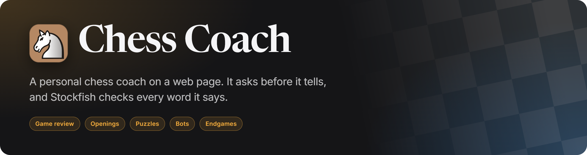
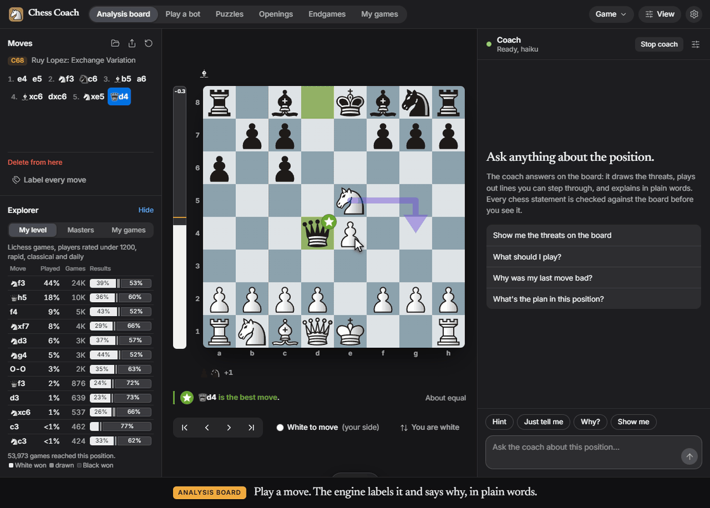
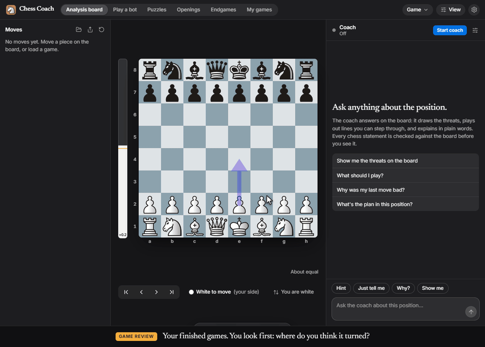
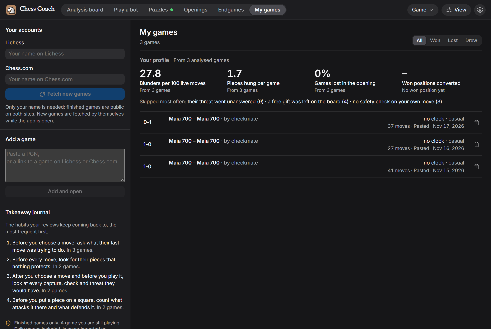
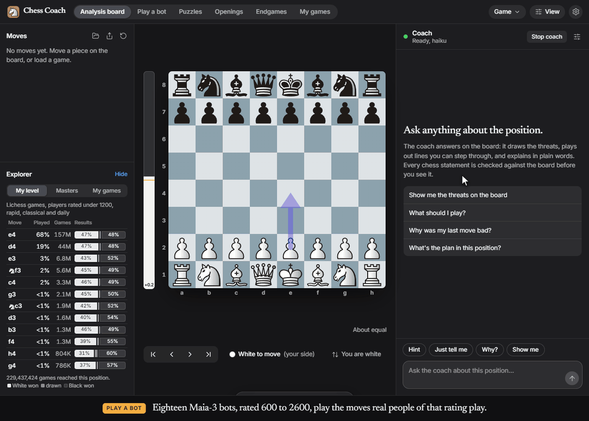
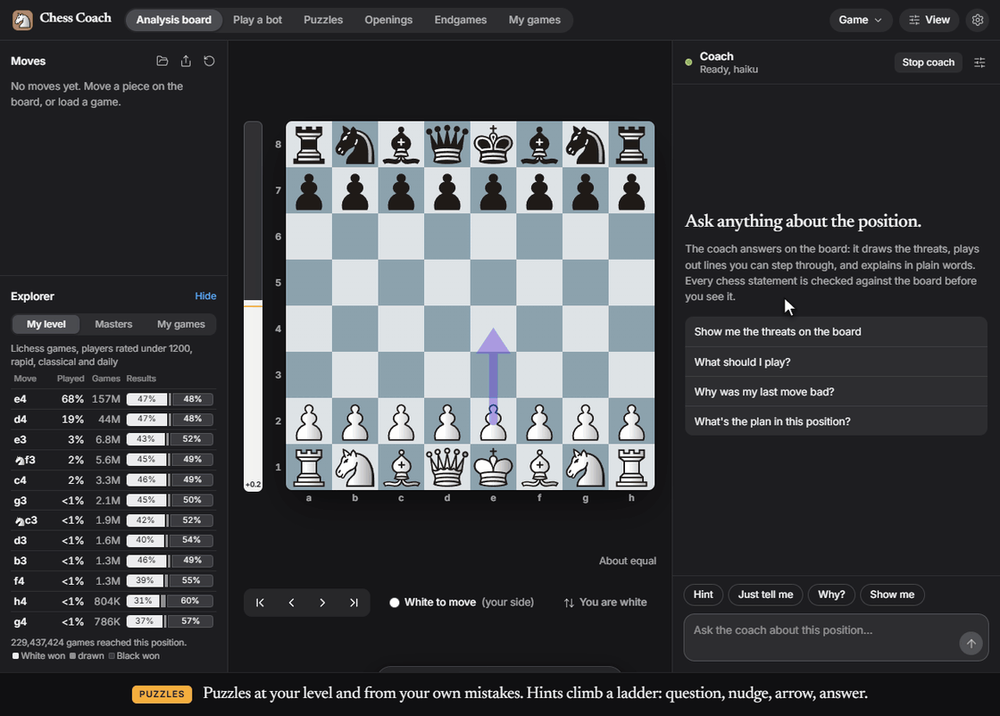
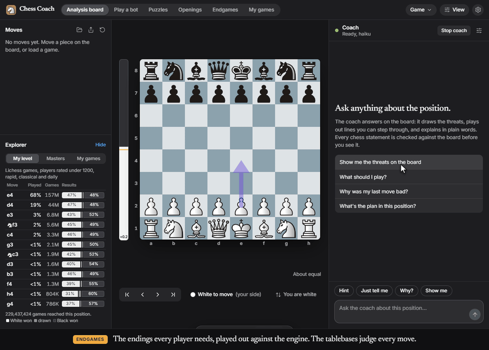
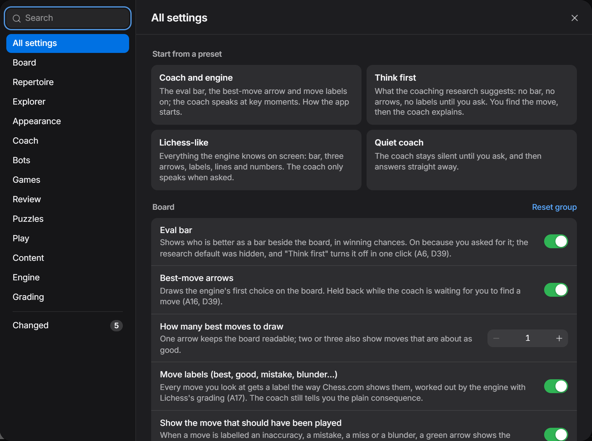
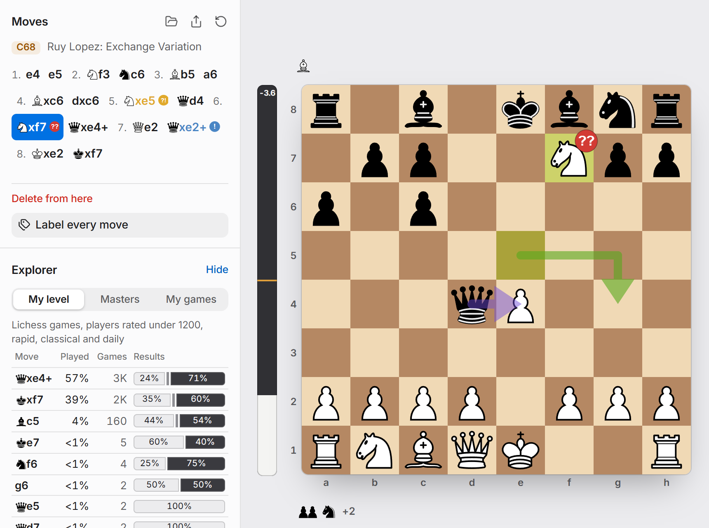
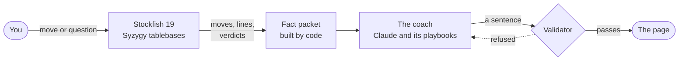

<p align="center">
  
</p>

<p align="center">
  
  
  
  
  
  
  
</p>

<p align="center">
  <a href="#the-tour"><b>The tour</b></a> &nbsp;·&nbsp;
  <a href="#how-it-stays-honest"><b>How it stays honest</b></a> &nbsp;·&nbsp;
  <a href="#what-is-built"><b>What is built</b></a> &nbsp;·&nbsp;
  <a href="#run-it"><b>Run it</b></a> &nbsp;·&nbsp;
  <a href="#the-docs"><b>The docs</b></a>
</p>

<p align="center">
  
</p>
<p align="center">
  <sub>Recorded from the running app with the live coach. Only the waits are cut: the coach and the engine thinking.</sub>
</p>

## What it is

Chess Coach is a web app for one learner: a beginner who wants a coach, not an engine printout. You
and the coach share one live board. Play a move and it is labelled in plain words. Blunder, and the
coach asks what you missed before it tells you. Ask anything, and the answer arrives on the board,
as arrows and lines you can step through.

The coach is Claude, running as a headless Claude Code session that the page starts by itself. It
never supplies a move from its own head. Stockfish originates every move, line and verdict, code turns
them into checked facts, and a validator refuses any sentence the board does not back.

> "I can't really learn just by playing moves Stockfish plays, since it's just looking 25–30 moves
> ahead and it's not the organic way for me to learn."
>
> The owner, in the project's requirements. The whole design follows from it.

<table>
  <tr>
    <td width="33%" valign="top">
      <h3>It asks before it tells</h3>
      Hints climb a ladder: a question, a nudge, an arrow, then the answer with its reason. The same
      thinking routine comes back everywhere: their threat, your checks, captures and threats, two
      candidates, a blunder check.
    </td>
    <td width="33%" valign="top">
      <h3>The engine checks every word</h3>
      The engine is the checker, not the teacher. No raw scores: "you lose a knight", never "−3.2".
      A sentence the board does not confirm never reaches the page.
    </td>
    <td width="33%" valign="top">
      <h3>It is built around your games</h3>
      Your finished games become one to three key moments, puzzles from your own mistakes, a skill
      profile and a journal of the habits that keep costing you.
    </td>
  </tr>
</table>

## The tour

Every clip below is the real page, driven by [`tools/readme-media.mjs`](tools/readme-media.mjs).
[The whole tour as one video](docs/media/tour.mp4) runs 2 min 42 s.

### Review your games, your way first

Finished games come in from Lichess and Chess.com by your public name, or as a pasted PGN. You look
first: the engine and the coach stay silent until you press Done. Then you get one to three key
moments, each with the step of the routine that was skipped, never a wall of engine lines. The coach
goes through them with you and asks before it tells. Each game ends in a short report.

<p align="center">
  
</p>

Reviews add up. *My games* keeps a skill profile counted from the games the engine has been through,
and a takeaway journal: the habits your reviews keep coming back to, the most frequent first.

<p align="center">
  
</p>
<p align="center">
  <sub>The games in these pictures were played between 700-rated Maia bots, the kind the app plays you against, so they have a beginner's mistakes in them and are nobody's real games.</sub>
</p>

### Play bots that play like people

Eighteen Maia-3 bots, rated 600 to 2600, play the moves real players of that rating play, mistakes
included. The roster suggests an opponent from your results. With the coach on, it agrees one focus
for the game and voices the thinking routine before your moves. It never suggests a move while you
play.

- Clocks and draw offers, and finished games go into *My games* for review.
- After a blunder the game offers to take it back and asks what was missed.
- Mini-games with few pieces: pawn war, queen against pawns, the rook mates.

<p align="center">
  
</p>

### Puzzles from your own mistakes

Puzzles are made from the moments in your own games where a better move was there, and themed sets
come from the Lichess puzzle database (6.19 million puzzles) at your level. Stuck? The hints climb
the ladder.

- A schedule brings each puzzle back when you are about to forget it (FSRS).
- Three more drills from your games: the safety check, "what's the threat?" and "win the won game".
- Each idea moves from *new* to *mastered* as you solve it without help, and that sets how much
  guidance the next puzzle gives.

<p align="center">
  
</p>

### An opening repertoire from the masters' games

A repertoire starts from your outline and is built out of the Lichess masters' database: every move
of every line was played in at least 25 master games, and the engine checks each move of yours. The
replies you prepare for are the ones players at your level actually play. Your moves come with their
why, written from checked facts, and the approved lines are drilled one position at a time.

<p align="center">
  
</p>

### Endgames against the tablebases

The endings every player needs, easiest first: the queen and rook mates, the two-rook ladder, the
square of the pawn, the opposition, Lucena and Philidor. You play each one out against the engine,
and the Syzygy tablebases judge every move. A go ends at the move that lets the win or the draw
slip, with the move that kept it.

<p align="center">
  
</p>

### Everything is a setting

There are 113 settings, each with a default and a one-line reason, and presets to start from:
*Coach and engine*, *Think first*, *Lichess-like*, *Quiet coach*. Light or dark, 13 board themes,
16 piece sets. Only the two [hard rules](#two-hard-rules) can't be switched off.

<table>
  <tr>
    <td width="50%"></td>
    <td width="50%"></td>
  </tr>
  <tr>
    <td align="center"><sub><b>Settings.</b> Every default says where it comes from.</sub></td>
    <td align="center"><sub><b>Light mode,</b> another board, other pieces.</sub></td>
  </tr>
</table>

## How it stays honest

A language model that talks about chess will, sooner or later, say something false with great
confidence. So the model is never trusted on a chess fact. If a change would need the model to
"know" chess, the design is wrong.



1. **The engine originates.** Every move, line, arrow and verdict comes from Stockfish 19, graded
   the way Lichess grades and cross-checked against Lichess's cloud analysis. Endgames are judged by
   the Syzygy tablebases.
2. **Code builds the facts.** For a position or a move, the server writes a fact packet: what hangs,
   what is threatened, what a move gives away. One function decides a move's label for the board,
   for the sentence under it and for the coach.
3. **The coach only explains.** It chooses what to say and how to say it, through tools: `get_facts`,
   `check_move`, `annotate`, `play_line`, `say`. Moves and squares are written as tokens, so each one
   can be checked.
4. **The validator decides.** Every message is checked before the page sees it: no chess notation
   outside a token, every token true on the board, every claim ("wins the queen", "mate in 2", "safe")
   backed by a fact, no engine numbers, words at the learner's level, and no answer where the
   playbook says ask first. On a refusal the coach tries again. After two, a scripted fallback speaks
   from the same facts, so you are never left waiting.
5. **Content goes through gates.** Nothing you study from is unverified. Puzzles, repertoire lines
   and their explanations go live only through the gates V1 to V8: legality, engine soundness, text
   claims, what people at your level really play, consistency, provenance, a second and deeper
   engine pass, and a teaching check.

The app also works with the coach off. Puzzles, drills, the schedule, the labels and the bots are
ordinary code, and the coach adds the conversation on top. The details are in
[ARCHITECTURE §9](docs/ARCHITECTURE.md#9-the-validator) and [CONTENT §5](docs/CONTENT.md#5-the-gates).

## What is built

| Area | What you get |
|---|---|
| **Analysis board** | The eval bar, best-move arrows, a label for every move with the reason in plain words, a green arrow for the move that should have been played, the board editor, studies, PGN in and out |
| **The coach** | Six coach agents, each with a written playbook: the analysis board, game review, puzzles and drills, games against bots, openings, endgames. The coach sits beside every board |
| **Game review** | Import by name from Lichess and Chess.com, your own review first, one to three key moments, the skipped step, the coach's questions, the report, the takeaway journal, the skill profile |
| **Puzzles and drills** | Puzzles from your own games, themed sets from the Lichess database, the hint ladder, the schedule, the safety check, "what's the threat?", "win the won game", optional Woodpecker rounds and speed runs |
| **Bots** | 18 Maia-3 bots from 600 to 2600, clocks, draw offers, take-backs that ask what was missed, mini-games, the sparring coach |
| **Openings** | Repertoires built from the masters' games, import from a PGN or a Lichess study, the why behind your moves, a trap pack, the drill, where each of your games left the repertoire |
| **Endgames** | 13 key positions and random starts for the basic mates, played against the engine with the tablebases judging |
| **Explorer** | What players at your level play in the position on the board, what masters play, and what you played |
| **Voice** | Off by default. The coach can read its messages out in a warm male voice, moves said in words, made on your own machine (Kokoro); you can ask out loud with the microphone beside the chat box, written down on your machine (Whisper) |
| **Settings** | 121 settings with reasons, four presets, light and dark, 13 board themes, 16 piece sets |

Phases 1 to 7 of the [plan](docs/PLAN.md) are done, and the repertoire work of Phase 8 is built. Next
come lessons and a curriculum, courses, the daily plan and progress, and the last pieces of parity
with Lichess and Chess.com. [TRACKER.md](TRACKER.md) is the source of truth for status.

## Two hard rules

These are code, not promises, and they are the only things that are never a setting.

- **Fair play.** The app never helps with a game in progress, Daily games included. Both sites ban
  it. A position from a game you are still playing is refused at the door and gets nothing from the
  engine or the coach. Only finished games are imported or reviewed.
- **Copyright.** Course files and books stay on your machine. They are never committed, uploaded or
  published, and a commit that contains them is refused by the pre-commit guard.

## Run it

It is a local app for one person. Everything runs on your machine and listens on `127.0.0.1` only.

```bash
npm install
npm run dev          # the server on 5174, the page with hot reload on http://127.0.0.1:5173
```

```bash
npm run build && npm start     # the built page and the server together on http://127.0.0.1:5174
```

| You need | For | Where it is set |
|---|---|---|
| Node 26 or newer | Everything. TypeScript runs on Node directly, with no build step for the server | |
| Stockfish 19 | Labels, facts, review, puzzles, content gates | `STOCKFISH` |
| Claude Code, signed in | The coach. Everything else works with the coach off | `CLAUDE_BIN` |
| Syzygy 3-4-5 tablebases | Endgames | `SYZYGY` |
| Python with Maia-3 | The bots | `MAIA_PYTHON`, `MAIA_MODELS` |
| A Lichess API token | The opening explorer | `LICHESS_TOKEN` in `.env` |
| The Lichess puzzle CSV | Themed puzzle sets: `npm run content:install -- puzzles` | |
| The voice models (577 MB) | The coach speaking and you talking: `npm run voice:install`, or *Download* under Settings → Voice | `VOICE_MODELS` |

The defaults are the paths on the owner's Windows laptop. Each one can be overridden from the
environment: see [`packages/server/src/config.ts`](packages/server/src/config.ts). Your games and
progress live in `data/`, which is never committed.

| Command | Does |
|---|---|
| `npm test` | The fast tests: no engine, no model |
| `npm run test:engine` | Tests against real Stockfish with a fake coach |
| `npm run test:page` | Builds the page and drives it in Chrome against a real server |
| `npm run test:coach` | The playbook harness: the live coach through 86 scripted scenarios, scored by code |
| `npm run check` | The type check, the linter, the docs check and the fast tests |
| `npm run content:validate -- <file or id>` | The content gates over puzzles or a repertoire, with the report |
| `npm run content:build -- <outline id>` | A repertoire built from an outline and the masters' games |

The full list, with the development tools, is in [CLAUDE.md](CLAUDE.md).

## How it is laid out

```
packages/core      pure chess logic, no I/O: grading, facts, the validator, puzzles, the gates
packages/server    the Node process: HTTP, WebSocket, the coach's tools, the engine, the database
packages/web       the page: Vite, React and chessground
.claude/           the coach's agents and playbooks
content/           the bot roster, mini-games, the trap pack, endgames, repertoire outlines
docs/              the ground docs
tools/             development tools: probes, screenshots, content builders
```

## The docs

| File | What it holds |
|---|---|
| [TRACKER.md](TRACKER.md) | The source of truth: phases, open questions, the decisions log, the session log |
| [docs/PLAN.md](docs/PLAN.md) | The build plan: the phases, their work packages, the tests that say a phase is done |
| [docs/ARCHITECTURE.md](docs/ARCHITECTURE.md) | How it is built: the coach bridge, the tools, the fact packet, the validator, the data model |
| [docs/FEATURES.md](docs/FEATURES.md) | The feature catalogue, in the owner's words where possible |
| [docs/COACH.md](docs/COACH.md) | The coach: agents, playbooks, the hint ladder, the test harness |
| [docs/CONTENT.md](docs/CONTENT.md) | Content sources, formats and the gates V1 to V8 |
| [docs/LEARNING.md](docs/LEARNING.md) | How chess coaches teach and how people learn. The coaching follows this |
| [docs/RESEARCH.md](docs/RESEARCH.md) | Engine-grounded coaching and the validation audit |
| [docs/REFERENCES.md](docs/REFERENCES.md) | Prior art, the Lichess open-source stack, Maia-3 |

## Built on

- [Stockfish](https://stockfishchess.org) for every move and verdict, and the
  [Syzygy tablebases](https://syzygy-tables.info) for the endgames.
- [Maia-3](https://github.com/CSSLab/maia3) from the CSSLab for bots that play like people.
- [Lichess](https://lichess.org) for most of the rest: the [chessground](https://github.com/lichess-org/chessground)
  board, the [chessops](https://github.com/niklasf/chessops) rules, the puzzle database, the list of
  openings, the opening explorer and the cloud analysis.
- [Claude Code](https://claude.com/claude-code) for the coach, with its tools served over the
  [Model Context Protocol](https://modelcontextprotocol.io).
- [Kokoro-82M](https://huggingface.co/hexgrad/Kokoro-82M) through [kokoro-js](https://github.com/hexgrad/kokoro) for the coach's
  voice, and [Whisper](https://github.com/openai/whisper) through [transformers.js](https://github.com/huggingface/transformers.js)
  for yours, both on [ONNX Runtime](https://onnxruntime.ai).
- [ts-fsrs](https://github.com/open-spaced-repetition/ts-fsrs) for the schedule, and
  [Inter](https://rsms.me/inter/) and [Newsreader](https://fonts.google.com/specimen/Newsreader) for
  the page's two voices.

## Licence

[AGPL-3.0-or-later](LICENSE). It is the licence that lets this project stand on Lichess's code and
Maia-3.
